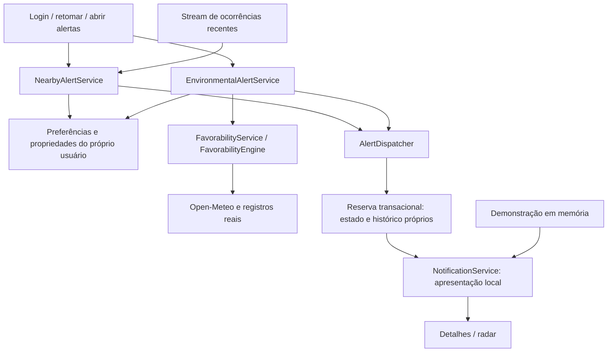

# AgroAdvisor — auditoria e notificações inteligentes

## Escopo e resultado

Implementação para o escopo acadêmico e os serviços gratuitos já utilizados:
Firebase Authentication, Cloud Firestore, Open-Meteo e notificações locais.
Não foi criado agendamento, serviço de execução em segundo plano, servidor
de envio, nova dependência, implantação ou habilitação de faturamento.

As verificações acontecem ao iniciar a sessão, retomar o aplicativo e abrir a
tela de notificações. A proximidade também acompanha mudanças nas ocorrências
recentes enquanto a conexão do cliente está ativa. O preventivo respeita um
intervalo em memória de seis horas entre avaliações bem-sucedidas; o botão
**Verificar alertas agora** força a avaliação, mas não contorna a deduplicação.
Esse intervalo não é um agendamento: com o aplicativo fechado não há um
processo confiável avaliando clima ou enviando novos alertas.

O índice é produzido pelo motor Dart existente, sem portá-lo para Node.js e
sem alterar a fórmula ou as regras heurísticas da etapa anterior. Os critérios
continuam experimentais, sem validação agronômica. Favorabilidade não equivale
a previsão científica de infestação, diagnóstico ou indicação de defensivos.

## Diagnóstico anterior

| Componente | Encontrado na auditoria | Tratamento |
|---|---|---|
| `NearbyAlertService` | Escuta Firestore no cliente, não um backend garantido | Preservado o mecanismo gratuito, com dependências injetáveis e política testável |
| Destinatários | Sem propriedades também eram notificados | Exige propriedade própria com coordenadas válidas |
| Distância | Haversine local duplicado, sem validação completa | Reutiliza Haversine e validação geográfica existentes |
| Preferências | Capturadas apenas na inicialização | Reconsultadas durante processamento e ao salvar configurações |
| Histórico próximo | `.add()` com ID aleatório e deduplicação em memória | Reserva transacional persistente; reconhece registros antigos por `occurrenceId` |
| Apresentação | O serviço próximo só gravava histórico | Agora solicita apresentação local depois da reserva |
| `PreventiveAlertService` | Executado após login; depende de organismo, regra científica e ocorrências | Mantido para o fluxo científico anterior; serviço complementar usa o perfil experimental genérico |
| Perfil experimental | Só avaliação manual, sem disparo | Serviço operacional oportunista consome diretamente o resultado do motor |
| Tokens FCM | Flag global de inicialização e assinaturas sem encerramento por conta | Registro protegido por sessão, cancelamento de assinaturas e remoção do token próprio no logout |
| Salvar preferências | Podia sobrescrever um token recém-rotacionado | `toMap()` de preferências não grava mais `fcmToken`; há método dedicado ao token |
| Toque | Sem tratamento local, `onMessageOpenedApp` ou `getInitialMessage` | Detalhes locais, payload de destinatário, lançamento a frio e compatibilidade FCM |
| Permissões Android | `POST_NOTIFICATIONS`, internet e localização já declaradas | Preservadas; solicita permissão local e verifica bloqueio do SO |

Ocorrências salvam latitude, longitude, autor e data; o diagnóstico pode ser
incluído no registro ou adicionado depois. A consulta recente e seu stream
detectam os dois casos. O radar continua usando sua geolocalização existente;
alertas monitoram as coordenadas cadastradas das propriedades, não o GPS atual.

### Cloud Function legada

`functions/index.js` foi auditado e sua sintaxe verificada, mas não foi alterado
nem implantado. `notifyNearbyUsers` usa apenas `onDocumentUpdated`: não cobre
criação que já contém diagnóstico, aceita usuários sem propriedade, usa testes
de coordenadas por valor verdadeiro/falso (rejeitando zeros válidos), persiste
IDs aleatórios e não possui reserva atômica ou remoção de tokens FCM inválidos.
Portanto, esse arquivo não deve ser apresentado como um backend validado para
este fluxo. Seu `package.json` não contém script de testes automatizados.

O fluxo entregue não chama essa função e não envia mensagens FCM. Se houver
uma versão antiga já implantada no projeto remoto, ela poderá operar
independentemente e duplicar alertas. O estado de implantação não foi acessado;
é necessário inventariá-lo no Console antes do ensaio. Não foi feita nenhuma
mudança em produção para desativá-la. Uma futura evolução de backend deve
resolver os problemas acima e compartilhar o protocolo de idempotência.

Cloud Functions exige plano Blaze segundo a [documentação oficial de
quotas](https://firebase.google.com/docs/functions/quotas). Não foi adotada
por causa da restrição explícita de serviços gratuitos.

## Arquitetura final

Os fluxos são independentes: falha de clima não interrompe os alertas de
proximidade; falha em ocorrências próximas não impede o início da avaliação
ambiental. O motor pode considerar uma consulta regional vazia e produzir
favorabilidade alta. Se a consulta regional do próprio motor falhar, em vez
de retornar vazia, ele mantém a condição de dados insuficientes.

### Ocorrências próximas

1. Consulta/escuta a janela de sete dias, já prevista no projeto.
2. Descarta autor igual ao destinatário, registro sem autor/ID/diagnóstico,
   diagnóstico saudável, data futura/antiga e coordenadas inválidas.
3. Carrega somente preferências e propriedades do usuário autenticado.
4. Encontra a propriedade válida mais próxima usando Haversine.
5. Aplica raio personalizado, incluindo o limite. Uma tolerância numérica de
   1e-9 km evita exclusão indevida por arredondamento de ponto flutuante.
6. Reserva o evento e grava histórico antes de solicitar notificação local.

Não há envio em massa pelo cliente nem leitura de documentos de tokens de
outros usuários. Dois destinatários executam a mesma política, cada qual na
sua sessão e nas suas propriedades.

### Favorabilidade preventiva

`EnvironmentalAlertService` utiliza `FavorabilityService.assessExperimental`,
que executa `FavorabilityEngine.assessExperimental`. O serviço usa dados
reais e rejeita resultados marcados como simulados antes de qualquer escrita.

As faixas reais são: baixo 0–29, moderado 30–54, alto 55–74 e muito alto 75–100.
Baixo/moderado registram a última avaliação sem solicitar apresentação local.
Alto/muito alto geram candidato preventivo; muito alto recebe título distinto.
Nenhuma nova fórmula é introduzida: o índice mantém 60% ambiental, 40%
regional, 72 horas de clima e evidências em 50 km/28 dias. Com três fatores
ambientais atendidos e zero registros, o motor retorna 60, classificado alto.

Cada avaliação salva estado resumido por propriedade, inclusive quando os
dados são insuficientes. Os detalhes da notificação guardam os fatores,
contribuições, índice, área e origem meteorológica. O texto recomenda
monitoramento e inspeção visual, sem afirmar que uma praga aparecerá.

## Histórico, deduplicação e entrega

Todos os documentos ficam em `notifications/{uid}/items`, já permitido pelas
regras de segurança existentes para o próprio usuário. Não houve alteração
em `firestore.rules`, credenciais ou configuração remota.

- `state_<chave>`: controle interno transacional, `type: _internal`, `read: true`.
- `alert_<chave_e_instante>`: evento visível, conteúdo, origem, região, nível,
  data, modalidade e estado da solicitação de apresentação.
- `evaluation_<propriedade>`: última avaliação, inclusive baixo/moderado ou
  dados insuficientes; interno, sem gerar contador de não lidas.

Chaves são codificadas sem colisão por substituição de caracteres. A conta é
parte do caminho; proximidade usa tipo + ID da ocorrência; preventivo usa
perfil versionado + propriedade + suas coordenadas. Um `runTransaction` lê
o estado e grava reserva e histórico atomicamente.

Proximidade reserva uma única vez por evento/destinatário. Preventivos
equivalentes são suprimidos durante 24 horas; mudança entre alto e muito alto
permite novo evento. O último nível **notificado** é a referência: uma
avaliação baixa intermediária não elimina a janela do mesmo nível alto.
O histórico mantém cada evento autorizado; o estado guarda a última reserva.
O horário do cliente participa da janela, exigindo relógio corretamente ajustado.

Estados registrados: `reserved`, `localSubmitted`, `permissionDenied`,
`localFailed` ou `sessionEnded`. O horário de persistência/tentativa usa
timestamp de servidor adicional. `localSubmitted` significa que o plugin
aceitou a chamada; não comprova entrega visual, leitura nem interação.

A reserva privilegia não duplicar: se o processo morrer depois da reserva e
antes de apresentar, o histórico pode continuar `reserved`, sem nova tentativa
automática. Falha ou permissão negada também não remove a reserva. O usuário
continua podendo consultar o histórico; conceder permissão depois não implica
reenvio imediato. Garantia de exatamente uma visualização não é possível
entre uma transação Firestore e uma chamada ao sistema operacional.

Transações exigem conexão. Sem ela, não há reserva nem solicitação local
operacional; reabrir/verificar com rede permite tentar novamente. Leituras e
escritas continuam consumindo as quotas gratuitas existentes. O cache
meteorológico compartilhado e o intervalo de seis horas reduzem consultas;
volumes grandes de ocorrências/propriedades exigiriam paginação e otimização.

## FCM e navegação

FCM continua como compatibilidade da infraestrutura existente, separado dos
alertas gratuitos. O handler background é registrado no ponto de entrada.
Em foreground, mensagens remotas recebidas podem ser apresentadas localmente;
o handler background não cria uma segunda notificação. `onMessageOpenedApp`
e `getInitialMessage` tratam abertura remota, sem criar um emissor de push.

Para notificações locais, o payload contém conteúdo e destinatário, nunca
token. O toque abre a tela de detalhes. O lançamento a frio recupera o payload
e o retém até a navegação estar pronta. Payload de conta diferente é
descartado; demonstrações não marcam documentos reais como lidos. Alertas de
ocorrência mostram ID/coordenadas e permitem abrir o radar existente. A
navegação não promete centralizar o mapa automaticamente naquele registro.

Tokens nulos, inválidos/indisponíveis ou rotacionados são tratados sem bloquear
a apresentação local. O cliente só salva o próprio token. Logout cancela as
assinaturas, invalida respostas tardias, tenta remover o token próprio e
cancela notificações locais do aparelho. A remoção remota pode falhar sem
rede. Não foi implementada nem testada remoção por erro de envio do servidor,
pois não existe emissor FCM no fluxo entregue. FCM multiaparelho ainda usa o
campo único legado; o histórico/transação compartilhados autorizam apenas o
dispositivo vencedor a solicitar apresentação local daquele evento.

## Demonstração na banca

### Favorabilidade

1. Faça login e abra **Perfil → propriedade → Painel da propriedade →
   Favorabilidade experimental**.
2. Ative **Modo demonstração**, escolha **Alto** e execute a avaliação.
3. Confirme índice 60 e o banner permanente de dados simulados.
4. Pressione **Gerar notificação local demonstrativa**.
5. Toque na notificação do Android para abrir os detalhes; os fatores também
   já podem ser consultados na tela. Se a permissão estiver negada, a interface
   informa o estado e a solicitação não é apresentada pelo SO.
6. Repita com **Muito alto** para índice 100; os cinco registros regionais
   existem apenas em memória.
7. Desative o modo: resultado e entradas simulados são descartados. O botão
   demonstrativo desaparece. A avaliação operacional permanece disponível.

### Ocorrência próxima

1. Configure o raio desejado em **Perfil → Alertas de pragas**, por exemplo
   20 km, e habilite notificações.
2. Abra o sino de **Notificações** e o botão com ícone de laboratório,
   **Demonstrar ocorrência próxima**.
3. Selecione uma das ocorrências fictícias e informe **8 km**: deve solicitar
   apresentação local identificada como demonstração.
4. Abra **detalhes demonstrativos** ou toque na notificação do SO.
5. Informe **20 km**: está no limite e deve permitir a apresentação.
6. Informe **21 km**: a interface informa que está fora, sem chamar o emissor.
7. Volte para sair da demonstração; nenhum histórico real ou ocorrência foi
   criado. Nada foi enviado a outro usuário.

As demonstrações não escrevem no Firestore. A tela de notificações operacional
pode continuar fazendo suas verificações reais independentemente; para uma
sessão totalmente isolada da produção, use um projeto de testes/emuladores.

## Roteiro Android com dois usuários

Este roteiro foi preparado, mas **não executado** nesta tarefa. Use usuários
de teste, dois dispositivos e projeto isolado para fixtures; não grave
ocorrências fictícias em coleções de produção.

| Passo | Procedimento | Evidência/resultado esperado |
|---|---|---|
| 1 | Instalar, autenticar A e B e conceder notificações Android 13+ | Canal habilitado e notificações permitidas nas configurações do SO |
| 2 | B cadastra localização monitorada válida e raio de 20 km | Propriedade e preferências próprias persistidas |
| 3 | A registra uma ocorrência diagnosticada a 12 km de B, em ambiente de teste | B aberto recebe um evento; A não recebe alerta de terceiro sobre si |
| 4 | Reprocessar o mesmo registro/abrir alertas várias vezes | Mesmo evento não duplica histórico nem apresentação |
| 5 | Usar evento distinto a 20 km e depois outro fora do raio | Limite incluído; fora excluído |
| 6 | Desativar preferências de B e criar novo evento | Nenhum alerta gerado para B |
| 7 | Testar B sem propriedade/coordenadas válidas | Nenhuma notificação de proximidade |
| 8 | Reativar; deixar B em segundo plano e registrar novo evento | Não exigir entrega imediata: não há execução garantida em background; retomar deve verificar |
| 9 | Encerrar normalmente B e registrar evento recente distinto | Não exigir alerta enquanto fechado; reabrir recupera o evento elegível dos últimos sete dias |
| 10 | Exibir notificação local, encerrar normalmente e tocar nela | Abertura a frio mostra detalhes; conta diferente não deve ver o conteúdo pela navegação |
| 11 | Executar preventivo com clima real alto ou fixture somente em projeto isolado, sem ocorrências | Histórico preventivo e solicitação local, índice alto do motor |
| 12 | Avaliar novamente e depois variar alto/muito alto | Equivalente suprimido por 24 h; mudança relevante permite novo evento |
| 13 | Negar permissão do SO e forçar verificação elegível | Histórico existe com estado de bloqueio, sem alegar visualização |
| 14 | Sair de B, entrar em C e simular rotação de token | Assinaturas antigas não gravam token nem apresentam alerta para a conta errada |
| 15 | Usar **Forçar parada** nas configurações Android | Reabrir manualmente antes de esperar novas mensagens/verificações |

Encerramento normal e interrupção forçada são estados diferentes. A
[documentação FCM para Flutter](https://firebase.google.com/docs/cloud-messaging/flutter/receive-messages)
informa que forçar parada no Android exige reabertura manual para mensagens
voltarem a funcionar. A mesma fonte descreve permissão Android 13+, tratamento
em foreground/background e abertura por notificações. Restrições do SO,
conectividade, economia de bateria e preferências podem impedir apresentação.
Essa compatibilidade não constitui evidência de push real: não houve envio FCM
em dispositivo físico nesta tarefa.

## Validação executada em 12/11/2026

- `flutter test --no-pub`: **230 testes aprovados**, incluindo 21 novos nesta
  etapa (17 de política/serviços/interface e 4 do canal local simulado).
- `flutter analyze`: nenhum problema novo; permanece código de saída 1 devido
  a duas observações preexistentes `unnecessary_underscores` na cópia aninhada
  `AgroAdvisor/lib/features/history/presentation/screens/history_screen.dart`,
  linha 395, colunas 47 e 51.
- `node --check functions/index.js`: aprovado. É verificação de sintaxe,
  não teste do trigger, Firestore Admin ou entrega FCM. O backend não possui
  script de testes; não se declara suíte de backend aprovada.
- Testes novos usam armazenamento em memória e mocks do canal Android,
  sem Firebase ou API meteorológica de produção. A reserva concorrente foi
  testada através da política/dispatcher, não contra um servidor Firestore.
- Firebase CLI não está disponível neste ambiente. Emulator Suite, regras
  aplicadas e transações reais concorrentes não foram validados por emulador.
- Os primeiros testes do canal local exigiram registrar o plugin Android no
  ambiente de teste; após corrigir a configuração do mock, passaram.
- Não foi executado teste manual em aparelho nem implantação remota.

## Evidências para o artigo e pendências

Anexar resultados da suíte e análise com data/versão; capturas dos dois tipos
de alerta; banner de demonstração; índice/fatores e origem; preferências/raio;
histórico e estados de apresentação; roteiro assinado de dois usuários;
teste do toque normal e a frio; ausência de duplicação após reabrir; e
comparação dentro/fora do raio. Remover e-mails, coordenadas privadas, IDs de
contas e qualquer token das capturas públicas.

Antes de afirmar funcionamento em produção, validar regras efetivamente
publicadas, quotas disponíveis, permissões do Android, ensaio em dois aparelhos,
transações concorrentes reais e eventual Cloud Function antiga implantada.
Não é necessário novo índice composto para os caminhos introduzidos: o
stream filtra `timestamp`, a busca legada filtra `occurrenceId` e o histórico
ordena `receivedAt`, separadamente.

Evolução futura possível: emissor backend com custos previamente autorizados,
tokens por dispositivo, paginação, relógio de servidor para a política,
retentativa controlada de apresentação e entrega observável. Não há modelo
científico validado nem garantia de previsão de infestação nesta implementação.

## Arquivos desta etapa

Novos: `environmental_alert_service.dart`, `intelligent_alert.dart`,
`intelligent_alert_store.dart`, `alert_session.dart`, `nearby_demo_screen.dart`,
`notification_detail_screen.dart`, dois arquivos em `test/notifications/` e
esta documentação.

Modificados: `app.dart`, `main.dart`, `nearby_alert_service.dart`,
`notification_service.dart`, `database_service.dart`, `occurrence_repository.dart`,
`user_settings_model.dart`, `notification_settings_screen.dart`,
`profile_screen.dart`, `app_notification_model.dart`, `notification_repository.dart`,
`notifications_screen.dart`, `favorability_screen.dart` e
`property_dashboard_screen.dart`. Os arquivos e alterações anteriores do motor
experimental foram preservados; não fazem parte de uma nova fórmula nesta etapa.
